# hrb_emp_assist

Parent project for the HRB (HR Benefits) chatbot platform — an HR benefits
assistant I'm building as a personal project, based on what I've been
learning about agentic AI systems and blending it with my software
engineering background to sharpen both. Grown from a single monolith
into an 8-repo platform (6 deployed backend services, 1 frontend SPA, 1
shared library).
This folder holds all 8 of those components as independent git repos (each with
its own GitHub remote and history, unaffected by living here), plus the
platform-level documentation that spans more than one of them.

## For reviewers (5 minutes)

Written for someone picking this up cold — a reviewer, a new engineer, or
the actual audience this whole project is built for: a Forward Deployed
Engineer walking into an unfamiliar system and needing to get oriented
fast, not just read about it.

1. [docs/architecture/platform-overview.html](docs/architecture/platform-overview.html) —
   the one page to start from: every business capability, which of the 8
   repos realizes it, one diagram tying it together, links into every
   component's own detailed docs.
2. The capability table and repo table below — same information, in plain
   markdown, if you'd rather not open an HTML file.
3. [docs/architecture/diagrams/README.md](docs/architecture/diagrams/README.md) —
   every current-state, target-state (scaling), and deployment diagram,
   indexed, as real editable `.drawio` files, not static images.

## Live demo

**[hrb-chatbot-ui.rvsree.dev](https://hrb-chatbot-ui.rvsree.dev)** - log in as
any persona from `hrb_chatbot_service/docs/agent-reference/KNOWN-PERSONAS.md`
(e.g. `EMP052` / Eddy Employee / employee). Backend services pause by default
for cost control (`scripts/apprunner-switch.sh {pause|resume|status}`) - if a
request hangs instead of answering, they're spinning back up, not broken.

## Tech stack

The real technologies behind the 8 repos, grouped by category - not every
dependency, just what each service's own README already names as "what's
actually used." (Renders natively here on GitHub - unlike the `.drawio`/
`.html` files elsewhere in this project, a fenced ` ```mermaid ` block
needs no separate viewer.)

```mermaid
flowchart TD
    HUB((HRB Chatbot<br/>Platform))
    HUB --> BE[Backend<br/>Frameworks]
    HUB --> AI[AI / RAG /<br/>Agents]
    HUB --> DATA[Data &<br/>Storage]
    HUB --> FE[Frontend]
    HUB --> MCP[Protocols &<br/>Integration]
    HUB --> INFRA[Infra &<br/>Deploy]

    BE --> BE1[FastAPI]
    BE --> BE2[Uvicorn]
    BE --> BE3[FastMCP<br/>hrb_lms_mcp]

    AI --> AI1[LangChain / LangGraph]
    AI --> AI2[NeMo Guardrails]
    AI --> AI3[Presidio + spaCy<br/>PII masking]
    AI --> AI4[DeepEval<br/>eval harness]

    DATA --> D1[Postgres / Neon]
    DATA --> D2[Pinecone + Chroma]
    DATA --> D3[Redis<br/>cache / rate-limit]

    FE --> F1[React 19]
    FE --> F2[TypeScript + Vite]
    FE --> F3[React Router]

    MCP --> M1[Model Context Protocol]
    MCP --> M2[OAuth2 client-credentials]
    MCP --> M3[SQLAlchemy]

    INFRA --> I1[AWS App Runner]
    INFRA --> I2[Docker, 2-stage builds]
    INFRA --> I3[AWS Lambda + SQS<br/>async ingestion]
    INFRA --> I4[GitHub Actions CI/CD]

    classDef hub fill:#4C1D95,color:#fff,stroke:#2E1065,stroke-width:2px
    classDef backend fill:#1D4ED8,color:#fff,stroke:#1E3A8A
    classDef ai fill:#047857,color:#fff,stroke:#064E3B
    classDef data fill:#B45309,color:#fff,stroke:#78350F
    classDef frontend fill:#BE185D,color:#fff,stroke:#831843
    classDef mcp fill:#7C3AED,color:#fff,stroke:#4C1D95
    classDef infra fill:#475569,color:#fff,stroke:#1E293B

    class HUB hub
    class BE,BE1,BE2,BE3 backend
    class AI,AI1,AI2,AI3,AI4 ai
    class DATA,D1,D2,D3 data
    class FE,F1,F2,F3 frontend
    class MCP,M1,M2,M3 mcp
    class INFRA,I1,I2,I3,I4 infra
```



Each repo's own README has a more detailed "Tech stack" table scoped to
that service.

## What this platform actually does

| Capability | What it means | Status |
|---|---|---|
| Benefits Q&A (RAG chat) | Ask about 401(k), healthcare, tuition, leave or disability policy, get an answer grounded in the actual HR knowledge base — 3 interchangeable modes (direct retrieve+generate, single ReAct agent, multi-agent planner+reviewer) | Live |
| Live HR data lookup | "What's my leave balance?" — answered via an actual tool call to live data, not a static document | Live |
| Unpaid-leave request (HITL) | A multi-day approval workflow — request submitted, an `hr_support` identity resolves it (approve/reject) days later, the employee is emailed the outcome, the conversation resumes exactly where it left off | Live |
| Document ingestion | HR uploads a benefits PDF; it's chunked, embedded, indexed so the next question can be answered from it | Live |
| Admin & platform ops | CI/CD pipeline visibility across all repos, golden-dataset viewer, eval-run history, live metrics, Interview Q&A editor | Live |
| 401(k) loan guidance | A hub/sub-agent router (loan, withdrawal, transfer, retirement), reusing the planner→domain-agents pattern already proven in multi-agentic-rag | Design only |
| Voice front door | Speech in, speech out — a transcription/synthesis wrapper in front of the existing chat capabilities | Design only |

## Why this is 8 services, not 1

This started as one FastAPI service doing ingestion, retrieval, and admin
together. It's now 8 independently deployable services. That split wasn't
aesthetic — three concrete things drove it:

**Decoupling.** Each backend used to duplicate its own CORS, auth, and
rate-limiting. Pulling that into one API Gateway (`hrb_api_gateway_service`)
means every other service can lock its CORS down to "only accept traffic
from the Gateway" and stop re-implementing the same cross-cutting code.
Worth being precise about what this actually buys: CORS only stops a
*browser* from calling the backend directly - it does nothing against a
server-to-server call or `curl`. Today the backend (`hrb_chatbot_service`)
still allows the production frontend's origin directly too, as a fallback -
so the Gateway's rate-limiting can currently be bypassed by calling the
backend directly. Real isolation would mean actually closing that direct
path, not yet done.

**Scaling independently.** Ingestion is bursty and I/O-bound (PDF
processing, embedding calls); retrieval is steady and compute-bound (LLM
calls, vector search); admin/platform tooling is low-traffic. One shared
deploy meant they could never scale or fail independently. Splitting them
means they do.

**Extensibility.** New capabilities — a 401(k) loan agent (A2A), a voice
interface — can be added as new services without touching anything that
already works, reusing the same Planner → domain-agent pattern already
proven in `hrb_rag_retrieval_service`'s multi-agentic mode.

**Where this actually stands today, not where it's "supposed" to be:** 7 of
7 planned services are built and live. The one piece still catching up: the
Gateway forwards every request to a single backend today — it doesn't yet
aggregate across services the way a full API Gateway eventually will, and
`hrb_rag_retrieval_service` is deployed and verified but not yet the one
receiving live production traffic. Both are known, scoped next steps, not
surprises.

## The 8 components

| Repo | Role | Status |
|---|---|---|
| [`hrb_chatbot_ui`](https://github.com/rvsree/hrb_chatbot_ui) | Frontend SPA (React) | Live |
| [`hrb_api_gateway_service`](https://github.com/rvsree/hrb_api_gateway_service) | Single public entry point — CORS, rate limiting, contract validation | Live |
| [`hrb_chatbot_service`](https://github.com/rvsree/hrb_chatbot_service) | Pre-split monolith; still the active retrieval backend in production today | Live |
| [`hrb_rag_ingestion_service`](https://github.com/rvsree/hrb_rag_ingestion_service) | Extract → chunk → embed → index, sync + async paths | Live, cut over |
| [`hrb_rag_retrieval_service`](https://github.com/rvsree/hrb_rag_retrieval_service) | Decompose → retrieve → generate — multi-agentic modes, HITL, conversation memory | Live, standalone (not yet cut over) |
| [`hrb_platform_components`](https://github.com/rvsree/hrb_platform_components) | CI/CD dashboard, Interview Q&A, MCP tool catalog | Live |
| [`hrb_common_libs`](https://github.com/rvsree/hrb_common_libs) | Shared connectors (observability/db/cache/auth/etc.), pip-installed via git tag | In use |
| [`hrb_lms_mcp`](https://github.com/rvsree/hrb_lms_mcp) | Live HR/leave data via MCP, real app-to-app OAuth2 — separate project, same platform | Live |

Full detail, resource identifiers, and the honest current-vs-target gap
for each one: [docs/architecture/platform-overview.html](docs/architecture/platform-overview.html).

## Documentation map

**Split 2026-10-26**: platform-level docs (span more than one repo) live
here, under `docs/`. Service-specific docs stay inside each repo's own
`docs/` folder.

| Here (platform-level) | What's in it |
|---|---|
| `docs/architecture/` | System/platform overview, microservices interface matrix and rollout plan, service-boundary decisions, DB model overview |
| `docs/architecture/diagrams/` | Every service's current-state, target-state, and deployment `.drawio` diagrams, indexed |
| `docs/auth/` | OAuth2 architecture (app-to-app, real; human-to-app, design), separate auth-server scope |
| `docs/platform-and-admin/` | Docs for `hrb_api_gateway_service`, `hrb_common_libs`, `hrb_platform_components` — hosted here since those repos' own docs are centralized |
| `docs/deployment-and-ops/build-and-deploy/` | Build + deployment architecture for every deployed repo |
| [docs/observability-governance.md](docs/observability-governance.md) | Which services have real LangSmith tracing vs. just scaffolded env vars, and what tracing data does (and doesn't) support for audit/governance |

| Per-repo (service-specific) | Where |
|---|---|
| RAG pipeline internals, agents/workflows, guardrails/evaluation, this repo's own deploy/monitoring loop | `hrb_chatbot_service/docs/dev-reference/hrb_chatbot_v3/` |
| SDD process history (phase-by-phase roadmap, backlog, coding standards) | `hrb_chatbot_service/docs/agent-reference/` |
| Each other repo's own build/run instructions | That repo's own `README.md` |

## Operating this platform

- **Cost control**: all AWS App Runner services pause by default — `scripts/apprunner-switch.sh {pause|resume|status}`. Resume before a demo, pause after (an AWS Budget alert and a LangSmith spend limit are also in place).
- **Observability**: traces at [smith.langchain.com](https://smith.langchain.com) (`hrb_chatbot_service_prod` / `hrb_chatbot_service_local`), app logs in CloudWatch (`/aws/apprunner/hrb-chatbot/.../application`).

## Functional vs non-functional status — where this platform is, honestly

This project tracks its own gaps openly rather than only showing what's
done. See each repo's own `BACKLOG.md`/`ROADMAP.md` for the full,
sequenced breakdown of what's built vs. planned (datasets, observability/
governance, resiliency, memory architecture, and more).

## Status

Reorganized 2026-10-24 into this parent-folder structure; platform-level
docs split out 2026-10-26. Each of the 8 child repos is independently
deployed and versioned — see each one's own `README.md` for its specific
build/run/test instructions. This parent folder itself is a separate,
private GitHub repo ([github.com/rvsree/hrb_emp_assist](https://github.com/rvsree/hrb_emp_assist)),
tracking only its own root-level files — the 7 child folders are
deliberately `.gitignore`d here since each has its own remote already.
