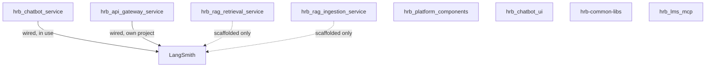

# Observability → Audit & Governance

How LangSmith tracing maps across the platform's 8 real components, and
what that tracing data actually supports (and doesn't) for audit/
governance purposes. Companion to
[hrb_chatbot_service/docs/agent-reference/testing-strategies.md](../hrb_chatbot_service/docs/agent-reference/testing-strategies.md),
which already draws the line between LangSmith traces and this project's
own golden/synthetic/live-query stores - this doc is the platform-wide
view of the tracing side specifically.

## Which components actually need tracing

LangSmith traces LLM/LangChain calls. Not every component makes any -
checked directly against each repo's own code, not assumed:

| Component | Makes real LLM calls? | LangSmith wired? |
|---|---|---|
| `hrb_chatbot_service` | Yes | **Wired, in use** (`hrb_chatbot_service_local`/`_prod`) |
| `hrb_api_gateway_service` | No (pure forwarder) | Has its own project (`api_gateway_service`) regardless - traces the gateway's own request handling |
| `hrb_rag_retrieval_service` | Yes - full genai pipeline, confirmed (`genai/pipeline.py`, `genai/response_generator.py`, `genai/retriever.py`) | **Scaffolded, not wired** - `.env.example` has `LANGSMITH_PROJECT=hrb_rag_retrieval_service`, but no tracing code exists anywhere in the service |
| `hrb_rag_ingestion_service` | Yes - metadata extraction during ingestion (`pipeline/metadata_extractor.py`) | **Scaffolded, not wired** - same gap, `LANGSMITH_PROJECT` set, no code |
| `hrb_platform_components` | No - confirmed zero LLM-calling files in its own `src/` | N/A (its own `.env.example` carries the var anyway, leftover from the split template - harmless, just unused) |
| `hrb_chatbot_ui` | No (frontend, calls the backend API) | N/A |
| `hrb-common-libs` | No (a library, not a running service) | N/A |
| `hrb_lms_mcp` | No (structured-data MCP server, not an LLM caller itself) | N/A |

**Recommendation**: wire `hrb_rag_retrieval_service` first - it's the service in line to actually replace `hrb_chatbot_service`'s own retrieval traffic (not yet cut over), so it needs the same observability before that cutover, not after. `hrb_rag_ingestion_service` second - lower urgency since metadata extraction is a one-time-per-document cost, not per-query.

## What LangSmith tracing actually supports for audit/governance

| Supports | Doesn't support |
|---|---|
| Who asked what, when - every real request's full input | No built-in compliance report generation |
| Step-by-step record of what the system did (retrieval, tool calls, generation) | No guaranteed PII redaction - raw query/answer text is traced as-is |
| Token/cost accounting per request | No long-term retention without paying - free tier is 14 days (confirmed live this session) |
| Error visibility - exactly where/why a request failed | No cross-service correlation today - a trace in `hrb_rag_retrieval_service`'s project and one in `hrb_chatbot_service`'s project for the "same" user action aren't linked |
| Filterable by metadata (request_id, when threaded through) | Not a dataset of record - this project's own `golden_dataset`/`synthetic_dataset`/`live_queries` stores exist precisely because LangSmith doesn't double as durable, structured test data (see testing-strategies.md) |

**The practical governance takeaway**: LangSmith tracing is a real, useful *debugging and spend-visibility* tool - it's not, by itself, a compliance/audit system. For HR benefits data specifically (potentially sensitive - leave reasons, medical/disability context), raw query/answer text passing through LangSmith's trace storage is worth knowing about explicitly, not assuming is scrubbed.

## Known constraints already hit this session

- **14-day retention, free tier** - confirmed live; traces older than that are gone, not archived.
- **Monthly trace quota** - confirmed live (the $70-incident investigation); a spend limit is now set ($5/month cap), but that caps spend, not retention.
- **Project naming drift** - production's own project was literally named after this service's *old* pre-rename name (`hrb_chatbot_v2`) until corrected this session - a reminder that scaffolded-but-unwired config (like `hrb_rag_retrieval_service`'s own `LANGSMITH_PROJECT`) can silently drift from reality if nobody's watching it.
